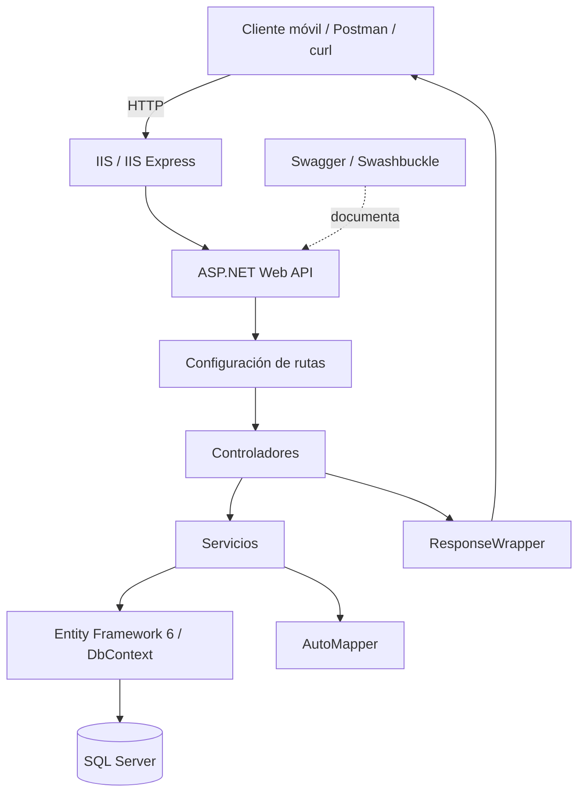
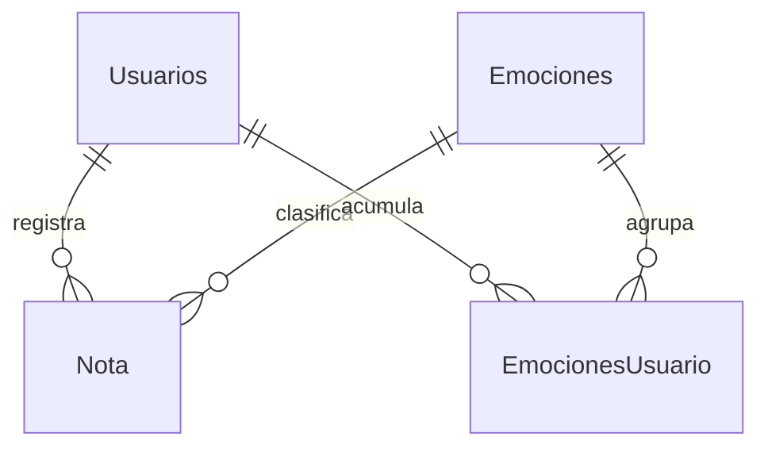

# Emotional.io API

Backend HTTP de **Emotional.io**, una aplicación móvil orientada al registro de notas asociadas a emociones. La API permite gestionar usuarios, crear y consultar notas emocionales, obtener el catálogo de emociones y consultar estadísticas sobre la frecuencia de las emociones registradas.

Desarrollado como parte de un proyecto universitario con **.NET Framework 4.8**, **ASP.NET Web API 5.3**, **Entity Framework 6** y **SQL Server**.

<p>
  
  
  
  
  
</p>

> **Nota técnica:** este proyecto utiliza ASP.NET Web API sobre .NET Framework. Sus controladores heredan de `ApiController`; por tanto, no es una aplicación ASP.NET Core ni una implementación de MVC clásico con vistas.

## Tabla de contenido

- [Funcionalidades](#funcionalidades)
- [Tecnologías](#tecnologías)
- [Arquitectura](#arquitectura)
- [Estructura del proyecto](#estructura-del-proyecto)
- [Patrones y prácticas de desarrollo](#patrones-y-prácticas-de-desarrollo)
- [Modelo de datos y persistencia](#modelo-de-datos-y-persistencia)
- [Endpoints](#endpoints)
- [Instalación y ejecución](#instalación-y-ejecución)
- [Ejemplos de uso](#ejemplos-de-uso)
- [Seguridad y limitaciones conocidas](#seguridad-y-limitaciones-conocidas)
- [Autor](#autor)

## Funcionalidades

### Usuarios

- Registro de usuarios con correo electrónico, contraseña y apodo.
- Comprobación de correo duplicado durante el registro.
- Autenticación mediante correo y contraseña.
- Consulta del apodo de un usuario.
- Eliminación de usuarios por identificador.

### Notas emocionales

- Creación de notas asociadas a un usuario y una emoción.
- Asignación de la fecha desde el servidor al registrar una nota.
- Consulta de una nota por identificador.
- Listado de notas por usuario o por fecha.
- Eliminación de notas por identificador.

### Emociones y estadísticas

- Consulta del catálogo de emociones.
- Cálculo de frecuencias desde el domingo más reciente hasta el día actual.
- Cálculo de frecuencias en un rango de fechas.
- Consulta de frecuencias filtradas por hora dentro de un rango de fechas.
- Identificación de la emoción más frecuente dentro de las consultas estadísticas.

## Tecnologías

| Tecnología | Versión identificada | Propósito |
|---|---|---|
| .NET Framework | 4.8 | Plataforma de ejecución de la aplicación. |
| ASP.NET Web API | 5.3.0 | Controladores, rutas y respuestas HTTP. |
| C# | No fijada explícitamente en el proyecto | Lenguaje de implementación. |
| Entity Framework | 6.5.1 | Acceso a datos relacionales mediante un modelo EDMX. |
| SQL Server | Según la base de datos configurada | Persistencia de usuarios, emociones y notas. |
| AutoMapper | 8.0.0 | Mapeo entre entidades y DTO. |
| Newtonsoft.Json | 13.0.3 | Serialización JSON. |
| Swashbuckle | 5.6.0 | Generación de documentación Swagger. |
| iTextSharp | 5.5.13.4 | Generación de PDF en un servicio no expuesto por un endpoint. |
| NuGet | `packages.config` | Gestión y restauración de dependencias. |
| IIS Express | Configurado en el proyecto | Servidor de desarrollo local. |

## Arquitectura

El proyecto es un **monolito web de un único proyecto**, con separación lógica por responsabilidades a través de carpetas y clases. No es Clean Architecture ni una arquitectura hexagonal, y no separa las capas en proyectos o ensamblados independientes.



### Responsabilidades principales

- **Controladores (`Controllers/`):** reciben solicitudes HTTP, seleccionan la operación y construyen la respuesta.
- **Servicios (`Services/`):** contienen la lógica de las operaciones y las consultas a la base de datos.
- **DTO (`Models/`):** definen parte de los datos de entrada y salida expuestos por la API.
- **Persistencia (`Data/`):** contiene el modelo EDMX, el contexto de Entity Framework y las entidades generadas.
- **Mapeo (`Infraestructura/`):** configura AutoMapper para convertir entidades y DTO.
- **Envoltura de respuestas (`Wrapper/`):** proporciona la estructura genérica `ResponseWrapper<T>`.

### Flujo de una solicitud

1. El cliente envía una solicitud HTTP al servidor web.
2. ASP.NET Web API resuelve la ruta a partir de la configuración global y los atributos de los controladores.
3. El controlador invoca el servicio asociado.
4. El servicio ejecuta la lógica y accede a los datos mediante `emocional_SampleDBEntities`.
5. AutoMapper transforma entidades y DTO cuando corresponde.
6. El controlador devuelve una respuesta JSON, habitualmente envuelta en `ResponseWrapper<T>`.

Los controladores crean las implementaciones concretas de los servicios mediante `new`; aunque existen interfaces, no se identificó un contenedor de inyección de dependencias.

## Estructura del proyecto

```text
api-emotionalio-aspnetframework/
├── ApiEmociones.sln
├── README.md
└── ApiEmociones/
    ├── ApiEmociones.csproj
    ├── packages.config
    ├── Web.config
    ├── Global.asax
    ├── Global.asax.cs
    ├── App_Start/
    │   ├── WebApiConfig.cs
    │   └── SwaggerConfig.cs
    ├── Controllers/
    │   ├── UsuarioController.cs
    │   ├── NotasController.cs
    │   └── EmocionesController.cs
    ├── Services/
    ├── Models/
    ├── Data/
    │   ├── DataContext.edmx
    │   ├── DataContext.tt
    │   └── DataContext.Context.tt
    ├── Infraestructura/
    │   └── MapperProfile.cs
    └── Wrapper/
        └── ResponseWrapper.cs
```

| Directorio o archivo | Responsabilidad |
|---|---|
| `Controllers/` | Endpoints y manejo de solicitudes HTTP. |
| `Services/` | Lógica de las operaciones y acceso a datos. |
| `Models/` | DTO de entrada y salida. |
| `Data/` | EDMX, contexto de Entity Framework y entidades generadas. |
| `Infraestructura/` | Perfil de AutoMapper. |
| `Wrapper/` | Estructura genérica de respuesta. |
| `App_Start/` | Registro de rutas y configuración de Swagger. |
| `Global.asax.cs` | Inicialización de la aplicación y configuración global. |
| `Web.config` | Configuración de ASP.NET, Entity Framework y conexión a la base de datos. |
| `packages.config` | Dependencias NuGet del proyecto. |

## Patrones y prácticas de desarrollo

| Patrón o mecanismo | Uso identificado |
|---|---|
| **Controladores de ASP.NET Web API** | Las clases que heredan de `ApiController` exponen operaciones HTTP mediante rutas y atributos. |
| **Service Layer** | Los controladores delegan las operaciones en servicios como `UsuariosService`, `NotasService` y `EmocionesService`. |
| **DTO (Data Transfer Object)** | Clases como `UsuarioDTO`, `LoginDTO`, `NotaDTO` y `EmocionDTO` representan datos transferidos a través de la API. |
| **Object Mapper** | AutoMapper configura las conversiones entre entidades y DTO en `Infraestructura/MapperProfile.cs`. |
| **Response envelope** | `ResponseWrapper<T>` agrupa datos, mensajes y un código de estado en el cuerpo de la respuesta. |

### Prácticas observadas

- Algunas operaciones de escritura utilizan transacciones explícitas de Entity Framework.
- Las consultas se encuentran en los servicios, en lugar de ejecutarse directamente en los controladores.
- Los mapeos de AutoMapper se registran durante el inicio de la aplicación.
- Los servicios capturan excepciones y, en varios casos, devuelven valores como `false`, `0` o `null` para indicar fallos.

### Patrones no identificados

No se encontró una implementación propia de Repository, Factory, Singleton o CQRS. Tampoco se identificó un contenedor de inyección de dependencias. Los servicios acceden directamente al contexto `emocional_SampleDBEntities`, por lo que existe acoplamiento entre la lógica de las operaciones y Entity Framework.

## Modelo de datos y persistencia

El acceso a datos utiliza **Entity Framework 6.5.1** y SQL Server. El modelo `DataContext.edmx`, junto con las plantillas T4 asociadas, indica un enfoque **Database First**. Los archivos disponibles respaldan esta clasificación, aunque no permiten reconstruir por sí solos todo el historial original de desarrollo de la base de datos.

### Entidades principales

| Entidad | Campos principales | Descripción |
|---|---|---|
| `Usuarios` | `id_usuario`, `correo`, `password`, `apodo` | Datos de la cuenta del usuario. |
| `Emociones` | `id_emocion`, `emocionNombre` | Catálogo de emociones disponibles. |
| `Nota` | `id_nota`, `id_usuario`, `id_emocion`, `texto`, `fecha` | Nota asociada a un usuario y una emoción. |
| `EmocionesUsuario` | `id_emocion_usuario`, `id_usuario`, `id_emocion`, `cantidad` | Entidad presente en el modelo; no se identificó uso en los servicios y controladores revisados. |

### Relaciones del modelo



El repositorio no incluye scripts SQL de creación ni migraciones que preparen automáticamente la base de datos. Para ejecutar la API se necesita una base compatible con el modelo EDMX y datos iniciales para las operaciones que consultan el catálogo de emociones.

## Endpoints

Las rutas siguientes se basan en los atributos de los controladores identificados en el proyecto. Sustituye `localhost:44313` por la URL configurada en tu entorno.

### Usuarios

| Método | Ruta | Entrada | Descripción |
|---|---|---|---|
| `POST` | `/Api/Usuarios/add` | JSON: `correo`, `password`, `apodo` | Registra un usuario. Rechaza correos duplicados. |
| `DELETE` | `/Api/Usuarios/remove/{idUsuario}` | `idUsuario` en la ruta | Elimina un usuario por identificador. |
| `POST` | `/Api/Usuarios/ingresar` | JSON: `correo`, `passwd` | Comprueba correo y contraseña; devuelve el identificador cuando son válidos. |
| `GET` | `/Api/Usuarios/ObtenerApodo?UsuarioID={id}` | `UsuarioID` en query string | Consulta el apodo del usuario. |

### Notas

| Método | Ruta | Entrada | Descripción |
|---|---|---|---|
| `POST` | `/Api/Notas/agregarNota` | JSON: `id_usuario`, `id_emocion`, `texto` | Crea una nota y establece la fecha en el servidor. |
| `DELETE` | `/Api/Notas/eliminarNotaPorID/{id}` | `id` en la ruta | Elimina una nota por identificador. |
| `GET` | `/Api/Notas/notaPorId/{id}` | `id` en la ruta | Consulta una nota por identificador. |
| `GET` | `/Api/Notas/notasPorUsuario/{userId}` | `userId` en la ruta | Lista las notas de un usuario. |
| `GET` | `/Api/Notas/notasPorFecha?idUsuario={id}&fechaBuscada=yyyy-MM-dd` | Identificador y fecha | Consulta las notas de un usuario en una fecha concreta. |

### Emociones y estadísticas

| Método | Ruta | Entrada | Descripción |
|---|---|---|---|
| `GET` | `/Api/Emociones/getAll` | Ninguna | Devuelve el catálogo de emociones. |
| `GET` | `/Api/Emociones/FrecuenciasSemanales/{idUsuario}` | `idUsuario` en la ruta | Calcula frecuencias desde el domingo más reciente hasta hoy. |
| `GET` | `/Api/Emociones/FrecuenciasConFechas?idUsuario={id}&inicio=yyyy-MM-dd&fin=yyyy-MM-dd` | Usuario y rango de fechas | Calcula frecuencias en un intervalo. |
| `GET` | `/Api/Emociones/FrecuenciasConFechasPorHora?idUsuario={id}&inicio=yyyy-MM-dd&fin=yyyy-MM-dd&horaSeleccionada={hora}` | Usuario, rango y hora | Filtra por hora y calcula frecuencias. |

### Formato general de respuesta

La clase `ResponseWrapper<T>` contempla los campos `Data`, `Message` y `HttpStatusCode`. El código actual no siempre alinea el código HTTP real con el valor de `HttpStatusCode` incluido en el JSON: algunas acciones devuelven HTTP `200` aunque el cuerpo represente un conflicto o un recurso no encontrado.

**Importante:** el análisis del código no encontró atributos `[Authorize]`, tokens ni filtros de autorización. El endpoint de inicio de sesión no implica que las demás rutas estén protegidas.

## Instalación y ejecución

### Requisitos

- Windows.
- Visual Studio 2022 con la carga de trabajo **ASP.NET y desarrollo web**.
- .NET Framework 4.8 Developer Pack.
- NuGet para restaurar los paquetes.
- SQL Server con una base de datos compatible con el EDMX.
- IIS Express (configurado en el proyecto) o IIS.

El proyecto depende de ASP.NET clásico y `System.Web`; no es directamente ejecutable como una aplicación ASP.NET Core ni en Kestrel. No se ha verificado su ejecución nativa en Linux o macOS.

### Pasos

1. **Clona el repositorio.** Sustituye la URL de ejemplo por la URL real del repositorio.

   ```bash
   git clone <URL-DEL-REPOSITORIO>
   cd api-emotionalio-aspnetframework
   ```

2. **Abre la solución.** Abre `ApiEmociones.sln` en Visual Studio 2022.

3. **Restaura las dependencias.** Visual Studio puede restaurar los paquetes automáticamente al compilar. Como alternativa, usa `nuget.exe`:

   ```powershell
   nuget restore ApiEmociones.sln
   ```

4. **Configura la conexión.** En `ApiEmociones/Web.config`, localiza la cadena de conexión `emocional_SampleDBEntities` y ajústala a tu entorno. Conserva el formato de conexión de Entity Framework asociado al modelo EDMX.

5. **Prepara la base de datos.** El repositorio no contiene scripts de creación ni un respaldo de la base de datos. Necesitas una base compatible con las entidades del modelo y datos iniciales de emociones.

6. **Compila la solución.** Desde Visual Studio, selecciona **Build > Build Solution**. También puedes usar una Developer Command Prompt:

   ```powershell
   msbuild ApiEmociones.sln /p:Configuration=Debug
   ```

7. **Ejecuta la aplicación.** Inicia el proyecto desde Visual Studio mediante IIS Express. La configuración incluida señala `https://localhost:44313/` como URL SSL y `50286` como puerto de desarrollo HTTP; pueden variar en tu entorno.

8. **Prueba un endpoint.** Por ejemplo, consulta el catálogo de emociones:

   ```bash
   curl -k "https://localhost:44313/Api/Emociones/getAll"
   ```

   La opción `-k` deshabilita la validación del certificado TLS y solo debe utilizarse para desarrollo local con un certificado no confiable. No la uses como práctica de producción.

Swashbuckle está configurado en `App_Start/SwaggerConfig.cs`; la disponibilidad de Swagger debe confirmarse al ejecutar el proyecto, por ejemplo en `https://localhost:44313/swagger`.

## Ejemplos de uso

Los ejemplos usan datos ficticios y presuponen que el servidor está ejecutándose y que la base de datos contiene los datos necesarios.

### Registrar un usuario

```bash
curl -X POST "https://localhost:44313/Api/Usuarios/add" \
  -H "Content-Type: application/json" \
  -d '{
    "correo": "usuario@example.com",
    "password": "contraseña-de-ejemplo",
    "apodo": "usuario"
  }'
```

### Iniciar sesión

```bash
curl -X POST "https://localhost:44313/Api/Usuarios/ingresar" \
  -H "Content-Type: application/json" \
  -d '{
    "correo": "usuario@example.com",
    "passwd": "contraseña-de-ejemplo"
  }'
```

Observa que el campo de contraseña del registro se llama `password`, mientras que el endpoint de inicio de sesión espera `passwd`.

### Crear una nota

```bash
curl -X POST "https://localhost:44313/Api/Notas/agregarNota" \
  -H "Content-Type: application/json" \
  -d '{
    "id_usuario": 1,
    "id_emocion": 1,
    "texto": "Nota de ejemplo"
  }'
```

La fecha se genera en el servidor, por lo que no se envía en el cuerpo de esta solicitud.

### Consultar notas por usuario y fecha

```bash
curl "https://localhost:44313/Api/Notas/notasPorFecha?idUsuario=1&fechaBuscada=2025-01-15"
```

### Consultar frecuencias entre fechas

```bash
curl "https://localhost:44313/Api/Emociones/FrecuenciasConFechas?idUsuario=1&inicio=2025-01-01&fin=2025-01-31"
```

## Seguridad y limitaciones conocidas

Este proyecto tiene fines académicos y **no debe considerarse listo para producción sin una revisión de seguridad y de manejo de errores**. El análisis del código identificó los siguientes puntos relevantes:

- **Contraseñas:** la autenticación compara la contraseña recibida directamente con el valor almacenado. No se identificó un mecanismo de hashing y salting para las contraseñas.
- **Autorización:** no se encontraron atributos `[Authorize]`, tokens ni filtros que protejan los endpoints. La mayoría de las operaciones no exige una sesión autenticada.
- **Validación de entrada:** la validación de campos y formatos de fecha es limitada; valores inesperados podrían producir excepciones.
- **Errores y estados HTTP:** algunas excepciones se convierten en valores genéricos y algunos estados de error se indican solo dentro del JSON mientras el HTTP real es `200`.
- **Pruebas:** no se identificaron proyectos de pruebas automatizadas ni configuración de integración continua.
- **Persistencia:** no se incluyen scripts de creación de base de datos ni datos iniciales.
- **Reporte PDF:** existe código de generación de PDF en un servicio, pero no se encontró un endpoint que lo exponga.

## Autor

**[MiguelDotDev](https://github.com/MiguelDotDev)**

Proyecto universitario: **Emotional.io**.
